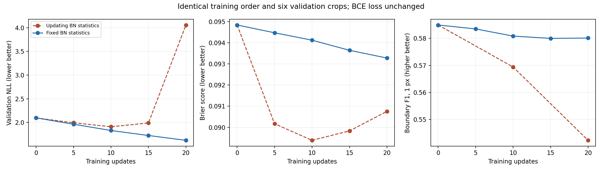

# Fixed BatchNorm statistics: controlled short run

Repeated the 20-update Big LaMa experiment from the same pretrained checkpoint, using identical seeds, training examples and their order, crops, learning rate 1e-5, batch size 1, and six held-out validation crops. Training again used `50052748`, `50052749`, and `50052751`. The fixed 10/2/2 map policy is unchanged, and no test examples were evaluated.

The only training-behavior change was setting BatchNorm modules to eval mode after every model.train() call. Their running buffers were frozen while affine scale and bias remained trainable. The new boundary metric is evaluation-only and did not change the unweighted masked BCE/NLL objective.

| Update | Previous validation NLL | Fixed-statistics validation NLL |
| ---: | ---: | ---: |
| 0 | 2.096929 | 2.096929 |
| 5 | 1.994015 | 1.963915 |
| 10 | 1.909645 | 1.830762 |
| 15 | 1.990460 | 1.725440 |
| 20 | 4.057059 | 1.623658 |

| Metric | Pretrained baseline | Previous best (10) | Previous final (20) | Fixed statistics (20) |
| --- | ---: | ---: | ---: | ---: |
| NLL | 2.096929 | 1.909645 | 4.057059 | 1.623658 |
| Brier | 0.094839 | 0.089385 | 0.090756 | 0.093276 |
| Accuracy | 0.903037 | 0.908664 | 0.907527 | 0.904399 |
| Wall IoU | 0.419373 | 0.419916 | 0.401627 | 0.416585 |
| Ten-bin ECE | 0.093351 | 0.087722 | 0.089483 | 0.091130 |
| Boundary precision, 1 px | 0.727381 | 0.790589 | 0.804768 | 0.745680 |
| Boundary recall, 1 px | 0.489140 | 0.444906 | 0.408886 | 0.474692 |
| Boundary F1, 1 px | 0.584932 | 0.569388 | 0.542261 | 0.580099 |



## Interpretation

NLL improved by 22.6% relative to the common pretrained baseline and decreased at every recorded evaluation. The previous late spike did not recur during these 20 updates. The best new checkpoint is update 20 and reproduced its validation scores after reloading.

Metrics show a tradeoff: new final NLL and tolerant boundary F1 are better than both retained previous-run checkpoints, but Brier and ECE are worse than the previous best. Exact IoU is slightly below the pretrained and previous-best values. Tolerant boundary F1 is also slightly below the pretrained baseline. This is evidence for fixing the observed normalization problem, not proof of universally better geometry or calibrated aleatoric uncertainty.

## What was verified

- Identical 20 training sample IDs and their order, dataset/crop settings, seeds, learning rate, and validation selection.
- All 456 BatchNorm running buffers (means, variances and counters) exactly match the original pretrained buffers.
- Learned affine scales changed in all 152 BatchNorm layers.
- Same 249,694 unknown non-padding validation cells; no test data used.
- All 31 portable tests pass, including one-pixel versus two-pixel wall shifts and exclusion of padding/mask artifacts.

## Spatial-tolerance metric

The metric thresholds occupancy at 0.5 and extracts four-neighbor occupied boundaries before applying the unknown-cell scoring mask. It counts a match within Euclidean distance 1 processed pixel (about 0.1 m at the configured scale). Precision measures predicted boundary matches; recall measures target boundary matches; F1 combines them. Counts are micro-aggregated across examples. This nearest-boundary metric is not a one-to-one matching algorithm.

Only unknown real-image boundaries are scored. Artificial image perimeters and computational padding are excluded. Known/unknown mask edges do not become invented boundaries. Both-empty boundary sets yield null scores; a single empty set yields zeros. A shifted wall can score well geometrically while still receiving the unchanged exact-cell BCE penalty.

## Reproduce

```bash
PYTHONPATH=.:lama python scripts/train_probabilistic_lama.py \
  --output work/probabilistic_frozen_reproduction --device cpu \
  --steps 20 --crop-size 256 --validation-crop-size 256 \
  --validation-samples-per-map 3 --validate-every 5 \
  --train-maps 50052748 50052749 50052751 \
  --freeze-bn-stats --boundary-tolerance-pixels 1
```

Local checkpoints and raw logs are in `work/probabilistic_frozen_bn_01/`. The best trained checkpoint is `best.pt` at update 20. No model checkpoint, dataset array, or new map image is uploaded. [All aggregate metrics and per-map results](frozen_bn_metrics.json).
