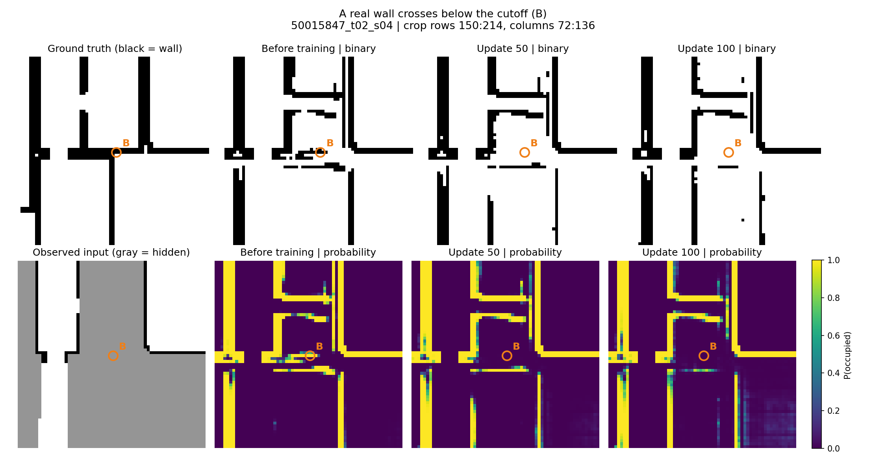
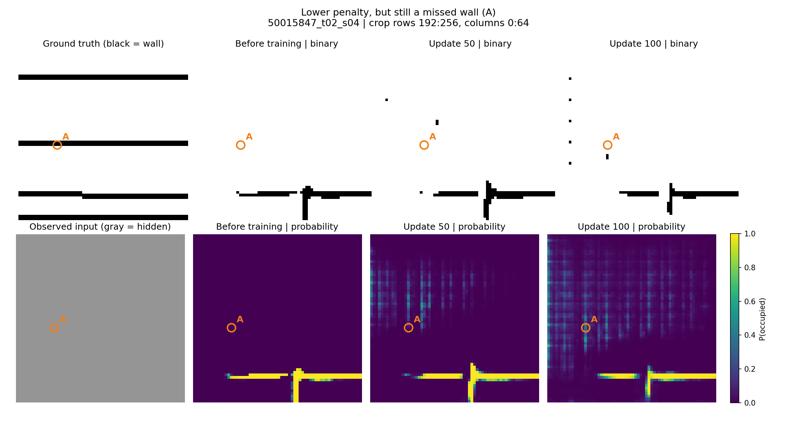
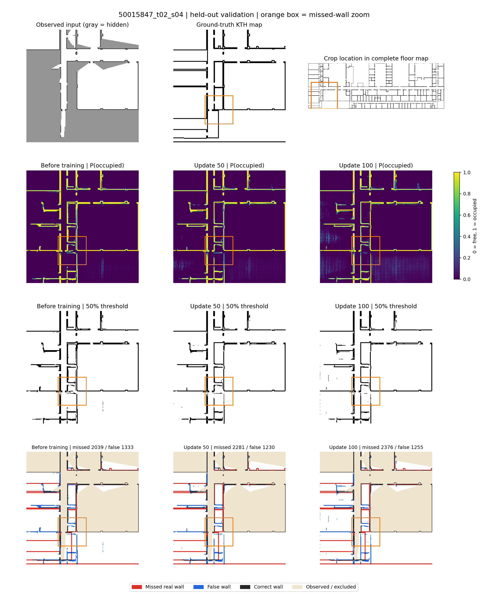
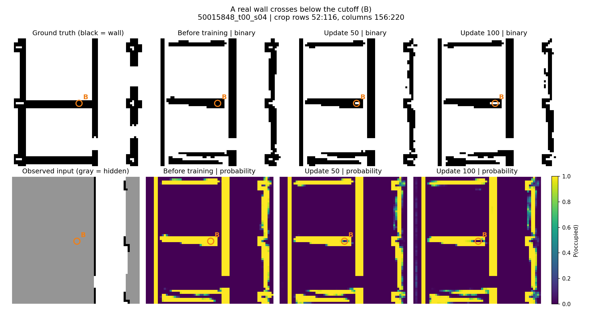
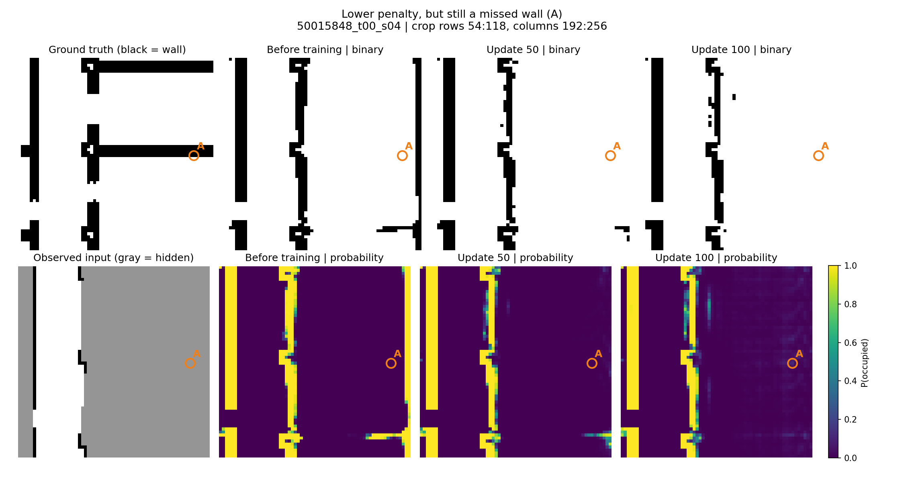
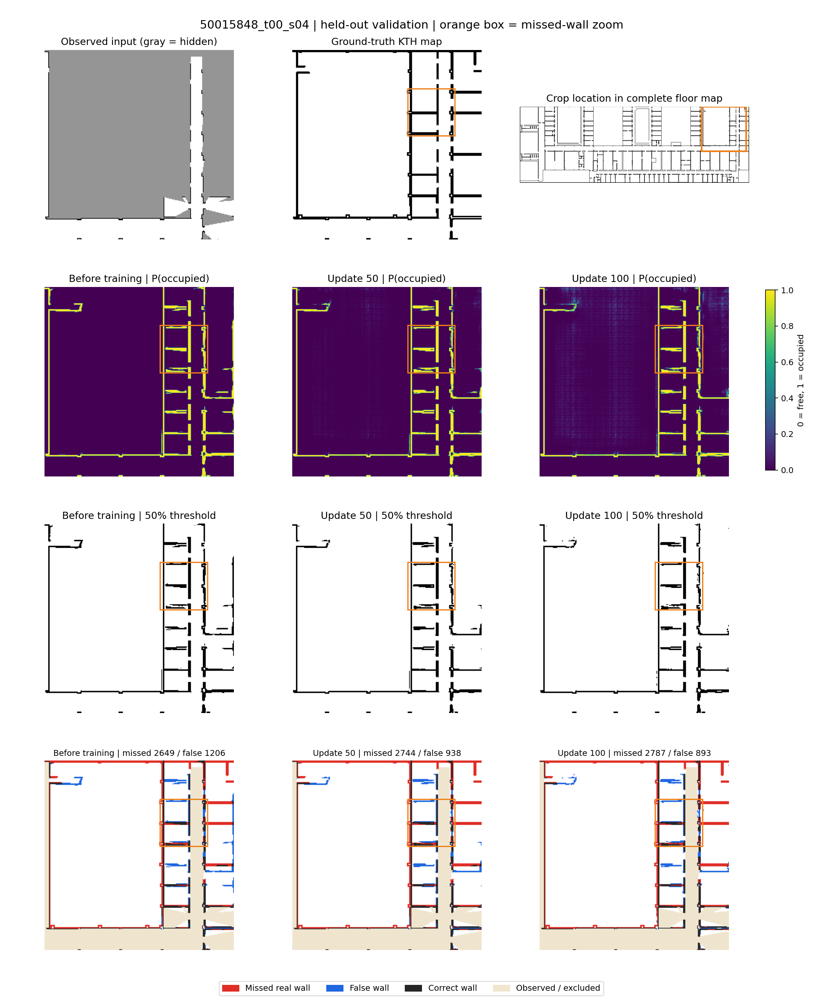

# Predictions versus KTH ground truth

Compared the same two held-out validation crops before training, after 50 updates, and after 100 updates. Ground truth here means the complete KTH occupancy map, not a photograph. No additional training was performed. The fixed 10/2/2 source-map policy remains unchanged, and no test examples were loaded.

## What the pictures show

**The model becomes less confidently wrong in many places, while also losing some real wall pixels.** About 97% of the net NLL improvement comes from cells that are incorrect at both endpoints. Their probabilities improve in aggregate without crossing the 50% cutoff needed to change the binary map. Newly lost real walls still receive a penalty, but those costs are outweighed by improvements elsewhere.

| Unknown-region pixel counts | Before | Update 50 | Update 100 |
| --- | ---: | ---: | ---: |
| Correctly predicted wall cells | 4826 | 4489 | 4351 |
| Missed real wall cells | 4688 | 5025 | 5163 |
| False wall cells | 2539 | 2168 | 2148 |
| Correct free cells | 74747 | 75118 | 75138 |

Training loses 550 previously correct wall cells and recovers 75, giving **475 more missed wall cells** overall. It removes 751 false wall cells and adds 360, giving **391 fewer false wall cells**. Thus it predicts fewer wall pixels overall, with both helpful removals and harmful omissions.

## How to read the figures

- Black-and-white panels: black is wall; white is free.
- Observed-input panels: gray is unknown. These are the inputs actually supplied to LaMa.
- Probability panels: purple is near 0% occupancy, yellow near 100%; all use the same 0–1 scale.
- Orange letters identify the same cell in ground truth and every prediction.
- Full-crop error maps: red is a missed real wall, blue is a false wall, dark gray is a correct wall, beige is observed/excluded.
- Known observations are preserved exactly in displayed completed maps. Counts and scores use unknown cells only.
- Zooms deliberately highlight informative examples; both full validation crops are also shown. These are illustrations, not randomly selected evidence.

## Validation example 1: `50015847_t02_s04`

### B: a real wall becomes a missed wall

At the orange **B**, ground truth contains a wall. It was above the 50% cutoff before training but falls below it afterward, so the displayed wall disappears at this location. The NLL penalty increases here; the loss is not giving this particular mistake a free pass.



| Cell B | Before | Update 50 | Update 100 |
| --- | ---: | ---: | ---: |
| Predicted chance of wall | 99.9995% | 0.2123% | 0.0582% |
| NLL penalty | 0.00001 | 6.15507 | 7.44824 |

### A: much lower penalty, but the wall is still missing

At orange **A**, ground truth also contains a wall. Its predicted chance of occupancy rises substantially, so the NLL penalty decreases. The probability remains below 50%, however, so the binary output still says free. The missing horizontal/room boundary is visible when compared with ground truth. Low-probability texture is not proof that the true wall geometry or calibrated uncertainty has been recovered.



| Cell A | Before | Update 50 | Update 100 |
| --- | ---: | ---: | ---: |
| Predicted chance of wall | ~0% | 5.2909% | 35.7674% |
| NLL penalty | 71.38227 | 2.93918 | 1.02813 |

### Complete crop comparison

The top row shows the input, ground truth, and crop location in the complete floor map. Subsequent rows show probability, thresholded maps, and color-coded errors. The orange rectangle locates zoom B.



## Validation example 2: `50015848_t00_s04`

### B: a real wall becomes a missed wall

At the orange **B**, ground truth contains a wall. It was above the 50% cutoff before training but falls below it afterward, so the displayed wall disappears at this location. The NLL penalty increases here; the loss is not giving this particular mistake a free pass.



| Cell B | Before | Update 50 | Update 100 |
| --- | ---: | ---: | ---: |
| Predicted chance of wall | 99.9866% | 7.1760% | 0.0098% |
| NLL penalty | 0.00013 | 2.63442 | 9.22985 |

### A: much lower penalty, but the wall is still missing

At orange **A**, ground truth also contains a wall. Its predicted chance of occupancy rises substantially, so the NLL penalty decreases. The probability remains below 50%, however, so the binary output still says free. The missing horizontal/room boundary is visible when compared with ground truth. Low-probability texture is not proof that the true wall geometry or calibrated uncertainty has been recovered.



| Cell A | Before | Update 50 | Update 100 |
| --- | ---: | ---: | ---: |
| Predicted chance of wall | ~0% | 0.8461% | 10.7138% |
| NLL penalty | 35.05795 | 4.77226 | 2.23364 |

### Complete crop comparison

The top row shows the input, ground truth, and crop location in the complete floor map. Subsequent rows show probability, thresholded maps, and color-coded errors. The orange rectangle locates zoom B.



## Is it only a one-pixel positioning problem?

Of the 550 newly missed wall cells, 334 (60.7%) are within one pixel of a remaining predicted unknown-region wall. That is consistent with some thinning or edge movement. The other 216 (39.3%) are farther away. Across all missed wall cells after training, 3,496 of 5,163 are more than one pixel from any predicted unknown-region wall. This proximity test does not establish a rigid spatial shift; nearby walls can also be unrelated.

A diagnostic cutoff sweep also fails to restore the original IoU among the thresholds tested. At update 100, a 30% cutoff gives IoU 0.3755 versus 0.3731 at 50%; both remain below the original 0.4004. Merely lowering the threshold is therefore insufficient in this check. No deployed threshold or training objective was changed.

## What this means for the loss

The score improvement is largely a reduction in excessive confidence on existing errors. That is useful for probability learning, but it does not guarantee better wall placement. BCE also penalizes newly missing walls; its total can still decrease because much larger penalties elsewhere have fallen. This is more specific than saying that the model is simply learning to predict free space everywhere.

This two-example training exercise is too small to establish the behavior of full-data fine-tuning. I recommend broader held-out validation and inspection of geometry/probability tradeoffs before changing the objective or starting the full-scale run. Test maps remain reserved.

## Reproduce and evidence

```bash
PYTHONPATH=.:lama python scripts/inspect_occupancy_predictions.py \
  --run work/probabilistic_two_fixed_100 --output work/inspection_new
```

Checkpoint inference was evaluation-only. Counts reproduce the prior run IoUs and NLL changes. All 35 portable tests pass, including error partition and zoom-coordinate checks. Full diagnostic arrays stay local; this report publishes two validation observations through six comparison figures, aggregate statistics, and selected illustrative cell values. [Machine-readable findings and cutoff sweep](metrics.json).
