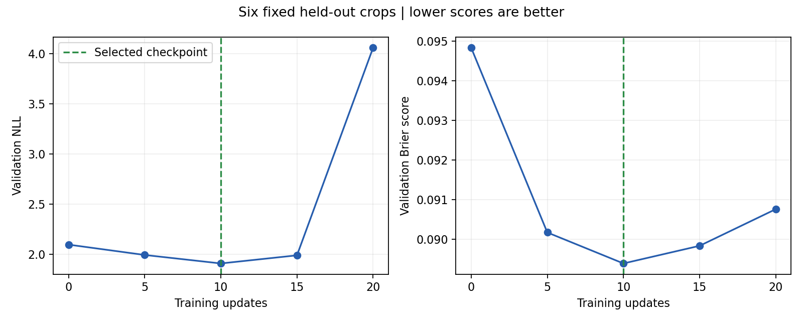

# Short probabilistic Big LaMa run

Completed 20 CPU updates at learning rate `1e-5`, batch size 1, with 256-pixel crops. Training used maps `50052748`, `50052749`, and `50052751` (107 available examples; 20 examples sampled: 6, 8, and 6 respectively). Gradient-update compute took about 56.5 seconds, excluding validation, loading and checkpoint I/O.

Validation used six fixed 256-pixel crops, three coverage-spaced examples each from `50015847` and `50015848`, with the same 249,694 unknown real-image cells evaluated at every checkpoint. The test split was not loaded.

| Metric | Before training | Best NLL checkpoint (step 10) | Final (step 20) |
| --- | ---: | ---: | ---: |
| NLL | 2.09693 | 1.90965 | 4.05706 |
| Brier score | 0.09484 | 0.08938 | 0.09076 |
| Occupied IoU | 0.41937 | 0.41992 | 0.40163 |
| Accuracy | 0.90304 | 0.90866 | 0.90753 |
| Ten-bin ECE | 0.09335 | 0.08772 | 0.08948 |

Best validation NLL improved by 8.9%; Brier improved by 5.8%. Wall IoU was nearly unchanged at the selected checkpoint. The later NLL increase shows instability: extending training did not reliably improve the objective. Use the step-10 best checkpoint, not the final checkpoint.



## Reproduce

```bash
PYTHONPATH=.:lama python scripts/train_probabilistic_lama.py \
  --output work/probabilistic_short_reproduction --device cpu \
  --steps 20 --crop-size 256 --validation-crop-size 256 \
  --validation-samples-per-map 3 --validate-every 5 \
  --train-maps 50052748 50052749 50052751
```

## Encoding correction and limitations

The first diagnostic run exposed an inverted adapter encoding and was discarded. The map checkpoint already encodes occupied=1/free=0. This accepted run uses that encoding directly and initializes the single output head from the positive mean of the RGB occupancy head. A regression test now checks equivalence to mean pretrained RGB occupancy logits. Earlier inverted checkpoints are rejected by the inference loader; accepted checkpoints use `encoding_version=2`.

This is a small crop-level experiment, not full-map evaluation or proof of calibrated aleatoric uncertainty. Probabilities still make confident errors. The next controlled experiment should investigate optimization/normalization stability and expand validation before scaling training. No extra training was run to select a more favorable result.

The best checkpoint was reloaded and reproduced the recorded validation NLL. Checkpoints and raw logs remain in `work/probabilistic_short_02/` in the cloud workspace and are excluded from Git. [Aggregate metrics](probabilistic_short_metrics.json) include every validation checkpoint and per-map baseline/best results.
