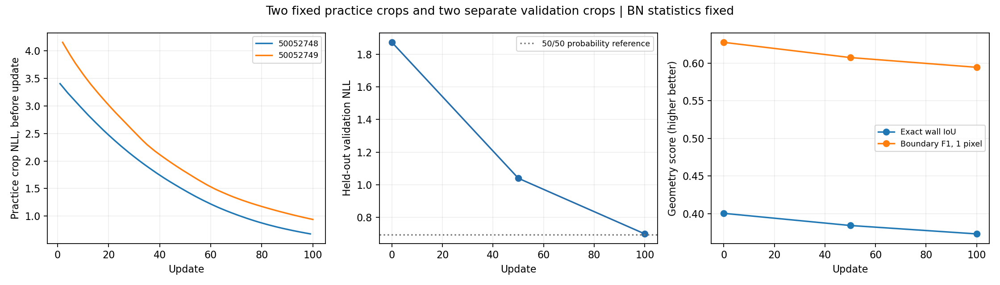

# 100 updates on two fixed crops

Completed the authorized 100-update learning check. Training repeatedly used two fixed crop windows, one each from training maps `50052748` and `50052749`. Validation used two separate fixed crop windows, one each from validation maps `50015847` and `50015848`. The original 10/2/2 source-map policy is unchanged; test examples were never loaded. The full-scale experiment has not started.

## Setup

- Big LaMa initialized from the original pretrained checkpoint, not the previous short-run weights.
- Adam learning rate 1e-5, batch size 1, 100 updates = 50 repeats per training crop.
- Training crop shapes: 218x256 and 256x256, with no resizing. Validation crops: 256x256 each.
- Frozen BatchNorm running statistics; learned scale/bias remain trainable.
- Exact unweighted masked Bernoulli NLL loss. One-pixel boundary tolerance is evaluation-only.
- Evaluation before training and at updates 50 and 100; 86,800 identical unknown validation cells each time.
- Training crop origins and byte-content fingerprints remained constant across all 100 updates.
- Both milestones were saved and reloaded; best validation NLL checkpoint was update 100.

## Key scores

| Metric | Before training | Update 50 | Update 100 |
| --- | ---: | ---: | ---: |
| Validation NLL | 1.872415 | 1.039715 | 0.699003 |
| Validation Brier | 0.081243 | 0.079925 | 0.079552 |
| Ten-bin calibration error | 0.079471 | 0.074350 | 0.061232 |
| Accuracy | 0.916740 | 0.917131 | 0.915772 |
| Exact wall IoU | 0.400398 | 0.384266 | 0.373092 |
| Boundary precision, 1 px | 0.663041 | 0.657987 | 0.641009 |
| Boundary recall, 1 px | 0.595552 | 0.563865 | 0.554025 |
| Boundary F1, 1 px | 0.627487 | 0.607301 | 0.594351 |
| Training NLL on the fixed pair, after updates | 3.822849 | 1.609186 | 0.797542 |



## Interpretation

The model learned the repeated practice examples: pooled training NLL decreased from 3.823 to 0.798. On the separate held-out pair, NLL decreased from 1.872 to 0.699, with smaller improvements in Brier and calibration error. Exact wall IoU and tolerant boundary F1 both declined. Better probability loss therefore did not produce an across-the-board improvement in map geometry.

This is a tiny learning check, not broad generalization or proven aleatoric calibration. These validation crops differ from the previous six-crop experiments, so compare only against this run baseline. The two practice crops were selected from source observations closest to 50% valid-space coverage, then cropped deterministically; observed fractions within the crops differ from source-map coverage.

## Probability references

| Constant prediction | Validation NLL | Validation Brier |
| --- | ---: | ---: |
| 50% occupancy everywhere | 0.693147 | 0.250000 |
| Training-pair occupancy rate (14.15%) | 0.350171 | 0.098609 |

Constant predictions contain no useful completed-map geometry. These references nevertheless show that the trained probabilities still have room to improve: their NLL does not beat the constant references, although their Brier score does. The occupancy-rate reference was estimated using training targets only.

## Fixed crop provenance

| Split | Sample | Crop origin (row, col) | Shape | Observed image fraction |
| --- | --- | --- | --- | ---: |
| train | 50052748_t02_s03 | (0, 0) | 218x256 | 20.18% |
| train | 50052749_t00_s03 | (0, 51) | 256x256 | 28.16% |
| validation | 50015847_t02_s04 | (186, 29) | 256x256 | 46.97% |
| validation | 50015848_t00_s04 | (0, 1049) | 256x256 | 20.59% |

## Reproduce

```bash
PYTHONPATH=.:lama python scripts/train_probabilistic_lama.py \
  --output work/two_fixed_reproduction --device cpu \
  --steps 100 --crop-size 256 --validation-crop-size 256 --validate-every 50 \
  --train-sample-ids 50052748_t02_s03 50052749_t00_s03 \
  --validation-sample-ids 50015847_t02_s04 50015848_t00_s04 \
  --fixed-training-crops --freeze-bn-stats --boundary-tolerance-pixels 1
```

All 33 portable tests pass. All 456 BatchNorm running buffers remained equal to the pretrained buffers. Gradient-update compute totaled 232.5 seconds, excluding validation, loading and checkpoint I/O. Checkpoints and full logs remain local in `work/probabilistic_two_fixed_100/`: `step_0050.pt` is the model-only midpoint snapshot, and `best.pt`/`last.pt` contain the update-100 training checkpoint. No new map images or model weights are uploaded. [All metrics, fixed-crop fingerprints, per-map scores, and training trace](two_fixed_100_metrics.json).
